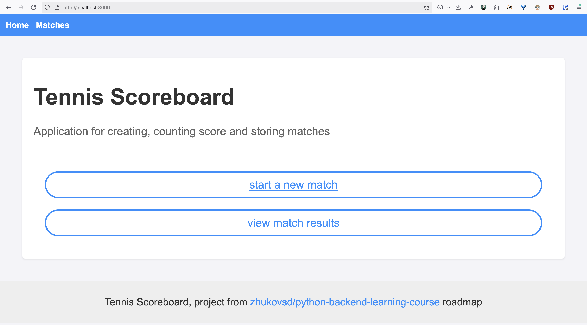
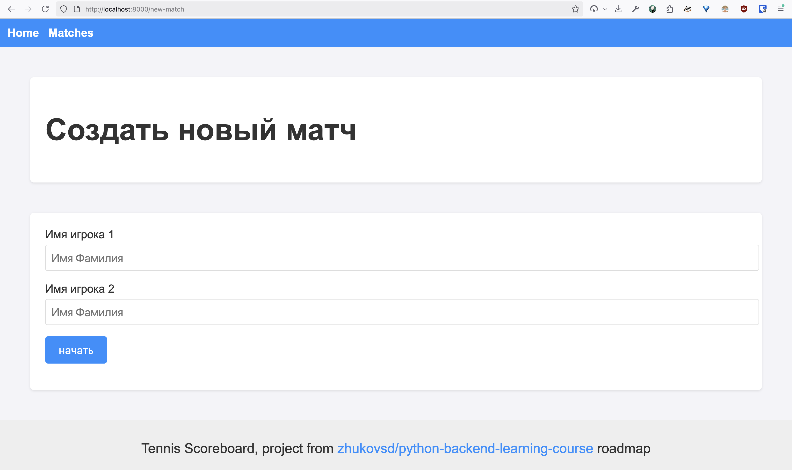
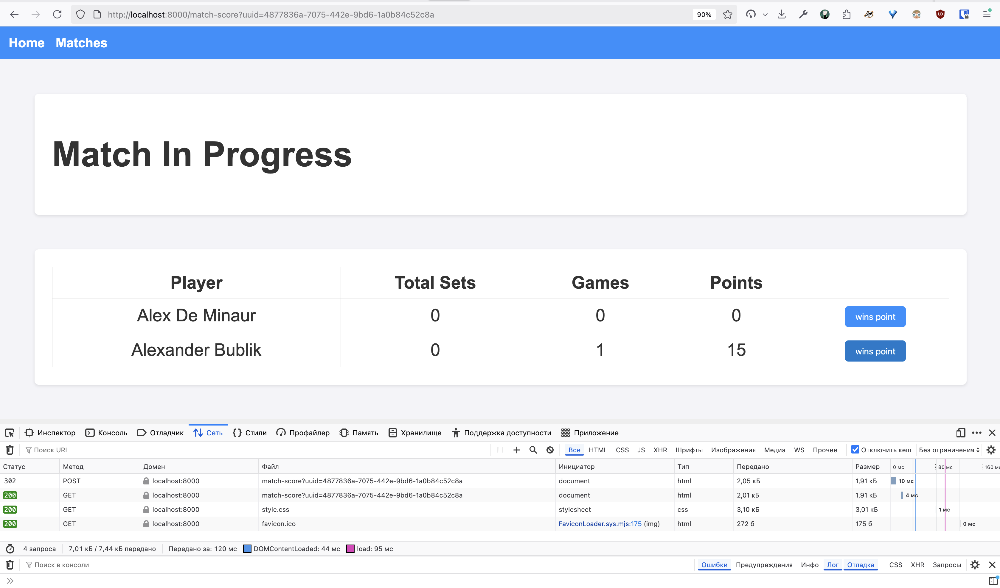
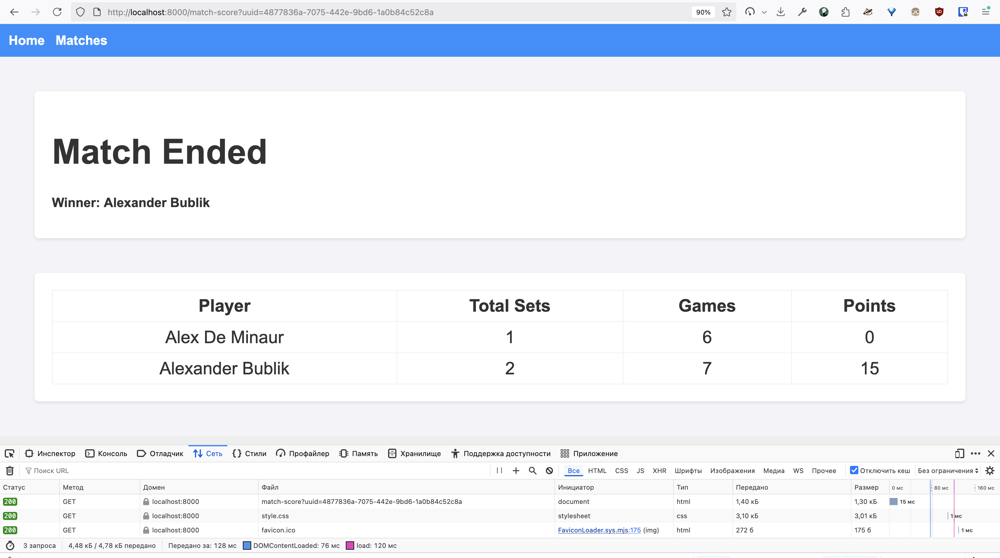
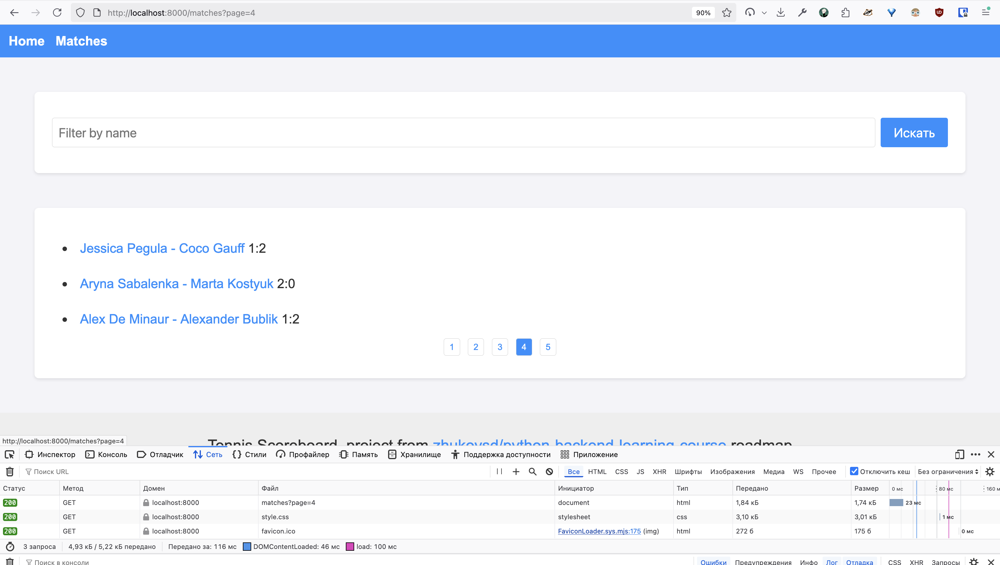

# Проект “Табло теннисного матча”

Веб-приложение, реализующее табло счёта теннисного матча.

### Технологии:
- MVC(S)
- pip/Poetry
- Backend:
    - uWSGI, Waitress
    - Веб - GET и POST запросы, формы
    - Jinja2
- Базы данных - MySQL, SQLAlchemy
- Frontend - HTML/CSS, блочная вёрстка
- Тестирование unittest
- Деплой - облачный хостинг

### Запуск приложения

```
uwsgi --http :8000 --wsgi-file wsgi.py
```

Приложение можно запустить после установки зависимостей ```pip install -r requirements.txt```. Также следует поменять endpoint mysql базы данных в *alembic/* и *app/database*, накатить миграции.

### Функционал приложения

Работа с матчами:
- Создание нового матча
- Просмотр законченных матчей, поиск матчей по именам игроков
- Подсчёт очков в текущем матче

### Описание страниц проекта

#### Стартовая страница

Предлагается создание нового матча и просмотр законченных матче.



### Страница нового матча 

Адрес - `/new-match`.

Представляет собой форму для создания нового матча.

Содержит два поля для ввода имен игроков и кнопку для отправления POST запроса.

Результатом нажатия кнопки будет редирект на страницу `/match-score?uuid=$match_id`



### Страница счёта матча

Адрес - `/match-score?uuid=$match_id`.

Представляет собой таблицу для ведения счета матча.

Нажатие кнопок приводит к POST запросу по адресу `/match-score?uuid=$match_id`, в полях отправленной формы содержится выигравший очко игрок.



Теннисный матч играется по системе BO3.
При достижении 2 сетов, игра считается завершенной. Определяется победитель и результат выводится на страницу.



### Страница сыгранных матчей

Адрес - `/matches?page=$page_number&filter_by_player_name=$player_name`.

GET параметры:
* `page` - номер страницы, если параметр не задан – первая страница.
* `filter_by_player_name` - имя игрока, матчи которого ищем.

Постранично отображает список сыгранных матчей и позволяет осуществлять поиск матчей по имени игрока. Для переключения страниц реализована пагинация.


